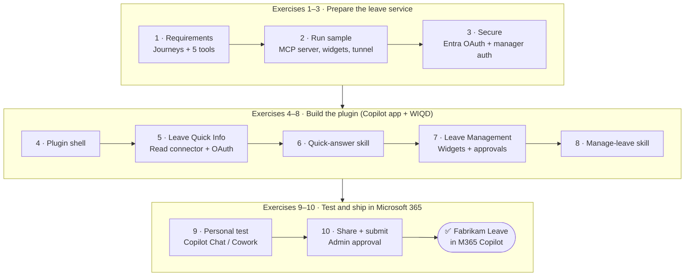

# Fabrikam People Hub: build a Copilot leave plugin with MCP Apps, connectors and skills

A hands-on workshop with a ready-made sample. Over **10 small exercises** you take an MCP server for employee leave from your laptop to your organisation's Microsoft 365 Copilot:

**MCP server → MCP Apps UI → dev tunnel → OAuth 2.0 + role-based authorization → WIQD plugin → 2 connectors → 2 skills → local test → publish and share**

> **Fictional company:** Fabrikam Pty Ltd, an Australian business (financial year runs 1 July to 30 June).
> **Demo cast:** Alex Chen and Priya Patel (employees) and Jordan Smith (manager).

---

## What you'll build

Each exercise adds a piece of the finished leave experience:


**By Exercise 8:** one plugin with **two connectors and two skills**, backed by the authenticated MCP server. **Exercise 9** verifies the live experience; **Exercise 10** makes it available to others, subject to administrator approval. Exercise 5's provisioning and package checks alone do not prove installation, user consent or live tool calls.

| Tool | Kind | Who | Connector |
|---|---|---|---|
| `get_leave_balance` | Data (read-only) | Everyone | Leave Quick Info |
| `get_working_days` | Data (read-only), financial year for tax | Everyone | Leave Quick Info |
| `create_leave_request` | **MCP App** (interactive form) | Everyone | Leave Management |
| `delete_leave_request` | **MCP App** (interactive list, two-step confirm) | Everyone (own requests) | Leave Management |
| `approve_leave_request` | Data | **Managers only** (`Leave.Approve` app role) | Leave Management |

> The brief mentioned 4 tools but described 5 capabilities. The sample implements all 5 so that "approve" can show authorization.

## Agenda (about 4 hours)

| # | Exercise | Time | You'll learn |
|---|---|---|---|
| 1 | [Understand the requirement and the toolchain](exercises/01-understand-requirements-and-tools.md) | 20 min | Plugin anatomy, federated (live MCP) connectors, GitHub Copilot + WIQD, MCP Apps |
| 2 | [Run the Leave MCP server locally with MCP Apps and a dev tunnel](exercises/02-run-mcp-server-and-dev-tunnel.md) | 30 min | Streamable HTTP MCP server, UI resources, demo users, dev tunnels |
| 3 | [Add OAuth 2.0 authentication and manager-only authorization](exercises/03-oauth-and-authorization.md) | 35 min | Entra ID app registration, JWT validation, app roles, RFC 9728 metadata |
| 4 | [Create a plugin with WIQD, with authentication](exercises/04-create-plugin-with-wiqd.md) | 20 min | `wiqd plugin create`, prepare Entra OAuth settings, env variables |
| 5 | [Connector 1: Leave Quick Info (quick services only)](exercises/05-connector-quick-info.md) | 20 min | OAuth vault registration, personal provisioning in dev, generated-package verification; separate live-test follow-up |
| 6 | [Skill for Connector 1](exercises/06-skill-quick-answers.md) | 15 min | `SKILL.md`, trigger phrases, references |
| 7 | [Connector 2: Leave Management](exercises/07-connector-manage-leave.md) | 15 min | Second connector, UI tools, destructive hints |
| 8 | [Skill for Connector 2](exercises/08-skill-manage-leave.md) | 15 min | Multi-step workflows, safe confirmations, authz-aware instructions |
| 9 | [Provision and test locally](exercises/09-provision-and-test-locally.md) | 30 min | Reprovision the personal dev deployment and test end to end, including the single-account role switch |
| 10 | [Publish to your organisation and share](exercises/10-publish-and-share.md) | 25 min | `provision/package/validate --env dev`, `share`, `publish`, admin approval |

From Exercise 4 onward, use the **GitHub Copilot desktop app with the WIQD agent**:
- 🗣️ **Say it:** paste the prompt into your app session with **wiqd** selected. Review the proposed changes and approve commands when prompted.
- ⌨️ **Optional terminal equivalent:** the `wiqd` commands are provided for reference, not as a requirement to use GitHub Copilot CLI.

WIQD still uses its CLI behind the app; neither the standalone GitHub Copilot CLI nor GitHub CLI (`gh`) is required for this authoring route. Test the resulting plugin in **Microsoft 365 Copilot Chat or Cowork**, not in the GitHub Copilot authoring app.

## Repository layout

```
fabrikam-leave-workshop/
├─ README.md                    ← you are here
├─ exercises/01..10-*.md        ← step-by-step lab guide
├─ mcp-server/                  ← ready-made Node.js MCP server (Exercises 2-3)
│  ├─ src/server.js             ← Express + Streamable HTTP, /mcp, /mcp/quick, /mcp/manage
│  ├─ src/tools.js              ← the 5 tools + MCP App resource registration
│  ├─ src/auth.js               ← AUTH_MODE=none|entra, JWT validation, role check
│  ├─ src/leave-logic.js        ← balances, FY working days, validation (unit tested)
│  ├─ src/store.js              ← JSON data store (data/seed.json → data/db.json)
│  ├─ widgets/                  ← MCP Apps UI (vanilla JS, built into single-file HTML)
│  ├─ scripts/                  ← build widgets, reset data, export tool descriptions
│  └─ test/                     ← node:test unit tests
├─ entra/setup-entra.sh         ← one-shot Entra ID app registration (Exercise 3)
└─ plugin-solution/appPackage/  ← finished plugin package for comparison (Exercises 4-8)
```

## Prerequisites

| Need | Why | Check |
|---|---|---|
| Node.js 24.15 or later | MCP server and current WIQD | `node -v` |
| GitHub Copilot desktop app | Conversational plugin authoring | Open the app and sign in to GitHub |
| WIQD (Work IQ Dev Tools) CLI + WIQD app plugin | Plugin lifecycle behind the app | **wiqd** is available in the agent selector; `wiqd doctor` passes |
| Dev Tunnels CLI | Public HTTPS URL for your local server | `devtunnel --help` |
| Azure CLI | Entra app registration script | `az version` |
| Microsoft 365 tenant with Copilot licences | Test and publish | Your account for local testing; 3 distinct accounts for the shared pilot |
| Roles | Entra: Application Developer (or Cloud App Admin) to register the app. M365: custom app upload allowed. Admin approval for publishing (Exercise 10). | |

## Quick start (if you just want to see it run)

```bash
cd mcp-server
npm install
cp .env.sample .env            # Windows: copy .env.sample .env
npm run build:widgets
npm run seed
npm test
npm run dev                    # http://localhost:3001/mcp
```

### Test with just your own account

After configuring Entra OAuth in [Exercise 3](exercises/03-oauth-and-authorization.md), set `TEST_USER_UPN` in `mcp-server/.env` to your sign-in name. From `mcp-server`:

```bash
npm run demo:role -- user       # Your account acts as E1001 (employee)
npm run demo:role -- manager    # Your account acts as M2001 (manager)
npm run demo:role -- off        # Restore normal account mappings and token roles
```

Restart the server after each switch. Requests and balances are preserved; no Entra app role changes or connector re-login are needed. See [Exercise 9](exercises/09-provision-and-test-locally.md) for the test sequence.

**Workshop-only:** OAuth token validation is unchanged, but the selected account's employee identity and approver role are simulated. This does **not** test real Entra role assignment. Never share or publish with `SINGLE_ACCOUNT_DEMO=true`; production mode rejects it.

Multi-account mappings use `EMPLOYEE_UPN`, `SECOND_EMPLOYEE_UPN`, and `MANAGER_UPN`, not fictional people's names. If upgrading an existing `.env`, rename the old person-specific keys; existing leave data does not need resetting.

## Important notes

- **WIQD is a public preview.** Commands and output can change. If a flag differs from this guide, run `wiqd <command> --help` or ask the WIQD plugin in GitHub Copilot.
- The **plugin-solution** folder is a reference for comparison. Your own project comes from `wiqd plugin create`, which also writes `m365agents.yml` and `env/` files for your tenant.
- Working-day and public-holiday numbers are **illustrative** (a national Australian set). This isn't tax advice.
- Never commit `.env`, client secrets or `env/.env.*.user` files.

## Further reading

- GitHub Copilot app setup: https://docs.github.com/en/copilot/get-started/quickstart-copilot-app
- App plugins and marketplaces: https://docs.github.com/en/copilot/how-tos/github-copilot-app/customize-github-copilot-app
- WIQD docs: https://microsoft.github.io/wiqd/
- Build a plugin with WIQD: https://microsoft.github.io/wiqd/getting-started/build-a-plugin/
- Plugin authoring reference (connectors, skills, validation codes): https://microsoft.github.io/wiqd/getting-started/plugin-reference/
- Configure remote MCP servers for plugins: https://learn.microsoft.com/plugins/configure-plugin-mcp-servers
- OAuth 2.0 for plugins: https://learn.microsoft.com/microsoft-365/copilot/extensibility/plugin-authentication-oauth
- MCP Apps in Microsoft 365 Copilot: https://learn.microsoft.com/plugins/plugin-mcp-apps
- MCP Apps in Cowork: https://learn.microsoft.com/copilot/cowork/mcp-apps-support
- Custom federated connectors: https://learn.microsoft.com/microsoft-365/copilot/connectors/set-up-custom-federated-connectors
- Structure reference (Zava Insurance sample): https://github.com/microsoft/mcp-interactiveUI-samples/tree/main/mcp-apps/zava-insurance/node
