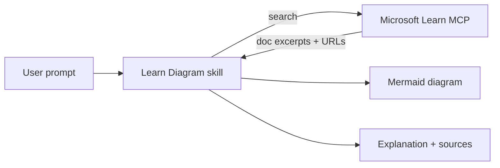

# Learn Visual Explainer: turn Microsoft Learn docs into diagrams

Build, install, and test a Copilot Cowork plugin that connects to the public
Microsoft Learn MCP server and ships a skill that turns official documentation
into clear, doc-grounded diagrams. Ask "show me how X works" for any Microsoft
technology, and the plugin searches Learn, picks out the real components and
flow, and draws them as a Mermaid flowchart or sequence diagram with source
links.

This recipe builds the whole plugin from scratch: the connector **and** the
skill. If you already completed
[Microsoft Learn MCP connector](../microsoft-learn-mcp/README.md), you can skip
to [Step 4](#step-4-add-the-learn-diagram-skill) from that plugin's root.

The server at `https://learn.microsoft.com/api/mcp` is free, uses streamable
HTTP, and does not require authentication. It currently exposes three tools:
`microsoft_docs_search`, `microsoft_docs_fetch`, and
`microsoft_code_sample_search`. The skill in this recipe relies mainly on
`microsoft_docs_search`, and uses `microsoft_docs_fetch` only when search
excerpts are too thin to draw from.

> [!NOTE]
> Markdown cannot execute commands directly. Start Copilot once, enter each
> prompt in the same session, and confirm its checkpoint before continuing.

## What you'll build

| Component | Name | Purpose |
|---|---|---|
| Connector (MCP) | Microsoft Learn | Searches and reads current official Microsoft documentation |
| Skill | Learn Diagram | Converts Learn search results into one accurate, labeled diagram |



## Before you start

You need:

- Node.js 24 or later
- `wiqd` v0.13.1 or later installed and signed in
- Access to Copilot Cowork
- Permission to provision and share an app in your Microsoft 365 development tenant

See [Getting started](../../README.md#getting-started) for installation and
sign-in instructions.

### Step 1: Check the environment

Start the WIQD Copilot agent. In the GitHub Copilot app, open the
**Default agent** selector and choose **wiqd**. If you prefer the CLI, run:

```bash
copilot --agent wiqd:wiqd
```

Enter this prompt:

```text
Check that my environment is ready to build and provision a plugin with WIQD. Confirm that Node.js is version 24 or later, WIQD is version 0.13.1 or later, I am signed in, and WIQD doctor reports no blocking errors. Help me fix any failed check before continuing.
```

**Checkpoint:** Copilot confirms that the environment is ready.

## Build the plugin

### Step 2: Create the plugin

Enter this prompt in the same Copilot session:

```text
Create a standalone plugin called Learn Visual Explainer. Its purpose is to explain how Microsoft and Azure technologies work by drawing diagrams grounded in official Microsoft Learn documentation.
```

**Checkpoint:** the current working directory is the generated plugin root and
contains `wiqd.plugin.json`, `m365agents.yml`, and `appPackage/manifest.json`.

### Step 3: Add the no-auth Microsoft Learn connector

Enter this prompt in the same Copilot session:

```text
Add a connector named Microsoft Learn to this plugin using the public MCP endpoint https://learn.microsoft.com/api/mcp. Configure it with no authentication. Inspect the server's current tools and include an MCP tool-description file in the app package so the connector can be verified by Copilot Cowork. Its purpose is to search and read current official Microsoft documentation and code samples.
```

Review and approve the proposed file changes.

**Checkpoint:** `appPackage/manifest.json` contains a Microsoft Learn entry in
`agentConnectors`, references a tool-description file in the app package, and
has no authorization block. The tool-description file lists
`microsoft_docs_search`, `microsoft_docs_fetch`, and
`microsoft_code_sample_search`.

### Step 4: Add the Learn Diagram skill

This is the step that makes the plugin visual. The prompt below describes the
complete skill, so you don't need an existing `SKILL.md` file. WIQD generates a
skill template, and Copilot replaces it with this workflow.

Enter this prompt in the same Copilot session:

```text
Use the supported WIQD plugin add command to add a skill named Learn Diagram to this plugin. Do not recreate or alter the Microsoft Learn connector.

Replace the generated skill template with this workflow.

Description (this decides when the skill triggers):
Draw a simple diagram of how a Microsoft or Azure service, feature, or flow works, grounded in Microsoft Learn documentation. Use when the user says "diagram", "draw", "visualize", "map out", or "show me how X works" about a Microsoft technology.

Instructions:
1. Identify the subject from the user's prompt, for example "Azure Front Door" or "Entra ID sign-in flow". Do not ask follow-up questions unless the subject is genuinely unclear.
2. Call microsoft_docs_search from the Microsoft Learn connector with a short query such as "<subject> architecture overview". Run a second search such as "<subject> how it works components" only if the first results are thin.
3. If the excerpts cut off a key step or component list, call microsoft_docs_fetch for the single most relevant page. Do not fetch more than two pages.
4. From the results, extract 4 to 8 main components, how they connect or the order in which things happen, and one short label per connection when the docs provide it. Use only what the documentation says. If something is unclear, leave it out rather than guess.
5. Choose the diagram type:
   - flowchart LR for architecture (which component talks to which)
   - sequenceDiagram for step-by-step flows (sign-in, request lifecycle, deployment)
   - two subgraphs side by side when the user asks to compare two technologies
6. Output exactly one Mermaid diagram in a mermaid code block. Use no more than 10 nodes or participants, and keep labels to 4 words or fewer.
7. Below the diagram, explain what it shows in 2 to 3 sentences.
8. End with a "Sources" list of the Microsoft Learn URLs you used, as markdown links.

Rules:
- Never invent components, ports, limits, or arrows that the documentation does not support.
- Say plainly when the documentation does not cover part of what the user asked. If there is not enough evidence for a diagram, explain the gap instead of drawing one.
- If the subject is not a Microsoft technology, say so and do not draw a diagram.

Include these example prompts in the skill:
- Diagram how Azure Front Door routes traffic
- Show me the Entra ID OAuth sign-in flow
- Visualize the parts of an Azure Functions app

Include this output structure in the skill, with placeholders to be replaced by documentation-grounded content:
- One mermaid code block containing the chosen diagram type
- A 2 to 3 sentence explanation of the diagram
- A Sources list with markdown links to the Microsoft Learn pages used

Show me the final skill file when you are done.
```

Review and approve the proposed file changes.

**Checkpoint:** the plugin contains a Learn Diagram skill folder with a
`SKILL.md` file. The skill is no longer a template, its description includes
the trigger words, and its instructions reference `microsoft_docs_search` and
`microsoft_docs_fetch` by their exact names. The connector configuration is
unchanged.

> [!TIP]
> The skill description is what Copilot Cowork reads to decide when to use the
> skill. If the skill doesn't trigger later, sharpen the description first,
> not the instructions.

### Step 5: Inspect and validate locally

Enter this prompt in the same Copilot session:

```text
Show me a summary of this plugin, then validate it locally with WIQD. If validation reports errors, explain and fix them before continuing.
```

**Checkpoint:** the plugin summary lists both `agentConnectors` (Microsoft
Learn) and `agentSkills` (Learn Diagram), and static validation completes
successfully.

## Install the plugin in Copilot Cowork

### Step 6: Provision the plugin

Enter this prompt in the same Copilot session:

```text
Provision this Copilot Cowork plugin.
```

**Checkpoint:** WIQD reports that **Learn Visual Explainer** was provisioned
successfully. If you extended an existing connector plugin, its original name
may still appear instead.

## Test it in Copilot Cowork

1. Open Copilot Cowork.
2. Open the plugin UI and find the provisioned **Learn Visual Explainer** plugin
   (or your existing plugin if you started at Step 4).
3. Install the plugin.
4. Start a new Copilot Cowork session with the plugin enabled.
5. Run each prompt below and confirm that Cowork uses the Learn Diagram skill,
   calls the expected connector tool, and returns a diagram with Microsoft
   Learn sources for supported subjects.

### Basic checks

| Prompt | Expected behavior |
|---|---|
| `Diagram how Azure Front Door routes traffic.` | Uses the Learn Diagram skill, calls `microsoft_docs_search`, and returns a `flowchart LR` with 4 to 8 components and Learn source links. |
| `Visualize the parts of an Azure Functions app.` | Returns a flowchart of triggers, functions, bindings, and hosting drawn only from documented components. |
| `What is the capital of France? Draw it.` | Declines to draw a diagram because the subject is not a Microsoft technology. |

### Show-stopper demos

These prompts push the skill past its examples. Run the first one first to
check sequence-diagram rendering and connector calls before a live demo.

| Prompt | What to verify |
|---|---|
| `Show me step by step what happens when a user signs into a web app with Entra ID using the OAuth 2.0 authorization code flow with PKCE, from clicking "Sign in" to getting the access token.` | Chooses `sequenceDiagram` and orders the exchanges between browser, app, and Entra ID using the documented flow. |
| `Visualize a serverless order-processing system on Azure: a web front end behind Front Door, orders going into Service Bus, processed by Azure Functions, stored in Cosmos DB, with events published to Event Grid.` | Grounds the proposed connections in documentation, stays under 10 nodes, and explicitly identifies any unsupported connections instead of inventing them. |
| `Diagram the difference between how Azure Container Apps and Azure Kubernetes Service handle scaling. Make it obvious which one does what.` | Uses side-by-side subgraphs and documentation-backed labels to distinguish the scaling behavior. |

**Checkpoint:** each supported, sufficiently documented scenario produces
exactly one Mermaid diagram, a short explanation, and a Sources list of
`learn.microsoft.com` links. The non-Microsoft prompt produces no diagram.
If documentation is insufficient, the response explains the gap instead.

### Step 7: Publish to your organization's registry

After testing, submit the plugin to your tenant's organization app catalog
for discovery, following the [WIQD quickstart](https://microsoft.github.io/wiqd/getting-started/quickstart/#step-6-share-for-preview-then-publish).
Enter this prompt in the same Copilot session from the plugin root:

```text
Package this plugin using the same environment I used to provision and test it, then validate the generated ZIP with WIQD package validation. Show me the findings and stop if validation fails or is incomplete. If validation passes, use WIQD plugin publish to submit this plugin to my tenant's organization app catalog using that same environment. Report the submission status and any administrator approval still required.
```

**Checkpoint:** WIQD reports a successful catalog submission. Submission is
not approval: a tenant administrator must approve the plugin before users can
discover it in the catalog. Direct sharing is a separate operation, and
publishing to the public store requires Partner Center submission and
certification instead.

## Troubleshooting

| Symptom | Likely cause | Fix |
|---|---|---|
| Cowork answers in plain text and never draws a diagram | The skill didn't trigger | Use a trigger word from the description ("diagram", "visualize", "show me how"), or ask Copilot to broaden the skill description and re-provision. |
| The diagram appears as raw Mermaid code | The surface doesn't render Mermaid | Inspect the diagram in a Mermaid viewer; rendering alone does not establish accuracy. |
| The response has no Sources list | The skill answered from memory instead of calling the connector | Confirm the connector is enabled in the session, then ask Copilot to reinforce the mandatory search step in the skill instructions. |
| The diagram has more than 10 nodes or long labels | The model ignored the limits | Ask Copilot to restate the limits as hard rules at the top of the skill instructions, then validate and re-provision. |
| Validation fails after adding the skill | The connector or manifest was changed while adding the skill | Ask Copilot to diff the manifest against the Step 3 checkpoint and restore the connector entry. |

## Clean up

If you submitted the plugin to the organization app catalog, coordinate with
your tenant administrator to withdraw the submission or remove the catalog
entry before deleting its provisioned resources.

Uninstall the plugin from Copilot Cowork when you finish testing. To remove the
provisioned test resources too, enter this prompt from the plugin root:

```text
Show me the provisioned resources associated with this plugin and the supported WIQD plugin delete options. Confirm the target plugin and environment with me before deleting anything. Remove only this test plugin's provisioned resources, preserve the local source files, and report any resources that need manual cleanup. Do not delete shared resources.
```

If you started from an existing connector plugin, keep it unless you intend to
remove that plugin and all the components you added to it.

## Go further

- Add a second visual skill, for example a **Learn Comparison Card** that calls
  `microsoft_docs_search` for two or three services and returns a side-by-side
  table.
- Combine this plugin with a declarative agent, as in
  [Upgrade the Learn connector into a technology advisor](../learn-tech-advisor/README.md),
  so the agent can draw a diagram after recommending a technology.
- Measure diagram accuracy with
  [Hill-climb agent quality with evals](../../lifecycle/eval-hill-climb/README.md).

## References

- [Build a plugin with WIQD](https://microsoft.github.io/wiqd/getting-started/build-a-plugin/)
- [WIQD plugin authoring reference](https://microsoft.github.io/wiqd/getting-started/plugin-reference/)
- [Microsoft Learn MCP Server overview](https://learn.microsoft.com/training/support/mcp)

---

Return to the [cookbook index](../../README.md).
